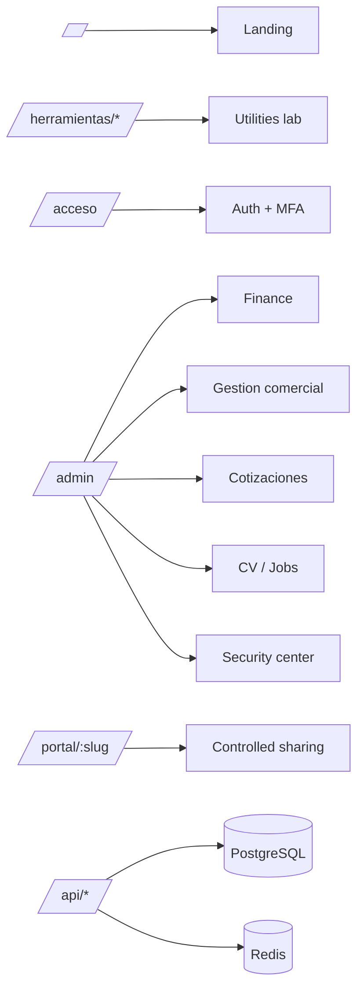
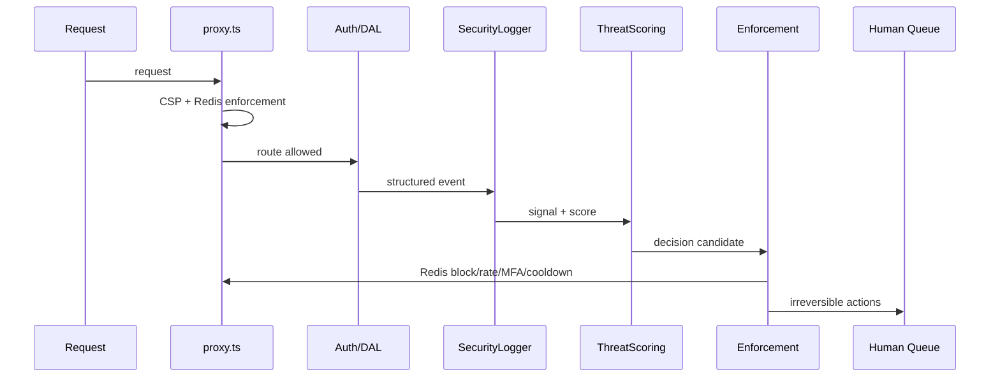

<div align="center">

# APP/NEXT_APP

**Aplicacion principal del Portafolio: Next.js 16, React 19, Prisma 7, Redis y modulos productivos reales.**

[](package.json)
[](package.json)
[](prisma/schema.prisma)
[](tests/e2e)
[](docs/SECURITY_OPERATIONS_RUNBOOK.md)
[](docs/SECURITY_OPERATIONS_RUNBOOK.md)

</div>

---

## Que Es

Esta carpeta contiene la aplicacion web principal del proyecto. Combina:

- experiencia publica de portafolio;
- herramientas tecnicas abiertas;
- panel administrativo;
- finanzas, gestion comercial, cotizaciones y portal de clientes;
- CV/jobs y automatizaciones de IA;
- seguridad operacional con auditoria, scoring, Redis y respuesta autonoma reversible.

---

## Stack Actual

| Capa | Tecnologia |
| --- | --- |
| **Runtime** | Node.js `>=22.22.0 <25` |
| **Package manager** | pnpm `10.33.0` |
| **Framework** | Next.js `16.2.4` + App Router |
| **UI** | React `19.2.4`, Tailwind CSS 4, Framer Motion, GSAP, lucide-react |
| **DB** | PostgreSQL + Prisma `7.8.0` |
| **Cache/control** | Redis client 5, Redis server 7/8 |
| **Auth** | NextAuth v5 beta, MFA/TOTP, Argon2id |
| **Tests** | ESLint 9, TypeScript 5, Playwright 1.57 |
| **Security tooling** | CodeQL, Trivy, Gitleaks, Dependabot |

---

## Rutas Y Modulos



| Area | Ruta | Notas |
| --- | --- | --- |
| Landing | `/` | Presentacion publica del portafolio |
| Acceso | `/acceso` | Login, MFA y recuperacion |
| Blog | `/blog` | Contenido editorial |
| Herramientas | `/herramientas/*` | QR, JSON, JWT, DNS, regex, imagenes, subredes, etc. |
| Admin | `/admin` | Dashboard interno |
| Finanzas | `/admin/finance` | Cuentas, presupuestos, metas, recurring, OCR, reportes |
| Gestion comercial | `/admin/gestion-comercial` | Clientes, pipeline, contratos, propuestas y pagos |
| Cotizaciones | `/admin/cotizaciones` | Gestion de cotizaciones y enlaces compartidos |
| CV / Jobs | `/admin/cv-editor`, `/admin/jobs` | CV builder, vacantes, aplicaciones y analisis |
| Seguridad | `/admin/security` | Incidentes, metricas y defensa autonoma |
| Superadmin | `/admin/superadmin` | Operacion avanzada del VPS |
| Portal | `/portal/[slug]` | Acceso compartido controlado |

---

## Estructura

```text
APP/NEXT_APP/
├── src/app/                 # App Router: paginas, layouts y route handlers
├── src/modules/             # Modulos de dominio reutilizables
│   ├── finance/
│   ├── landing/
│   ├── cv/
│   ├── pulse/
│   └── quotations/
├── src/lib/                 # Auth, Redis, Prisma, seguridad, auditoria, SOAR-lite
├── src/components/          # Componentes UI compartidos
├── prisma/                  # Schema, migraciones y seed
├── scripts/                 # Operaciones, seguridad y mantenimiento
├── tests/e2e/               # Playwright
├── docs/                    # Runbooks, guias y specs
└── public/                  # Manifest, iconos, PWA/offline assets
```

---

## Instalacion Local

```bash
corepack enable
corepack prepare pnpm@10.33.0 --activate
pnpm install --frozen-lockfile
cp .env.example .env
pnpm exec prisma migrate dev
pnpm exec tsx prisma/seed.ts
pnpm run dev
```

Servidor local: `http://localhost:3000`.

---

## Scripts

| Comando | Uso |
| --- | --- |
| `pnpm run dev` | Prisma generate + Next dev |
| `pnpm run build` | Prisma generate + Next build |
| `pnpm run start` | Servidor Next de produccion |
| `pnpm run lint` | ESLint con `--max-warnings 0` |
| `pnpm run typecheck` | `tsc --noEmit` |
| `pnpm run test:e2e` | Playwright |
| `pnpm run security:check` | lint + typecheck + audit + build |
| `pnpm run security:prod` | audit prod high+ |
| `pnpm run security:false-positives -- --days 7 --min-score 70` | Revision de falsos positivos |

> `pnpm audit` consulta el registry de npm y puede exponer inventario de dependencias. Ejecutarlo solo cuando el operador apruebe esa salida de datos.

---

## Variables De Entorno

Partir desde `.env.example`. Minimo para desarrollo:

```env
DATABASE_URL="postgresql://..."
NEXTAUTH_URL="http://localhost:3000"
NEXTAUTH_SECRET=""
ENCRYPTION_KEY=""
PASSWORD_PEPPER=""
INTERNAL_API_SECRET=""
REDIS_URL="redis://:password@localhost:6379"
IP_HASH_SECRET=""
AUTONOMOUS_DEFENSE_MODE="dry-run"
AUTONOMOUS_DEFENSE_AUDIT="true"
```

Generadores recomendados:

```bash
openssl rand -base64 32    # NEXTAUTH_SECRET / INTERNAL_API_SECRET
openssl rand -base64 48    # ENCRYPTION_KEY
openssl rand -hex 32       # PASSWORD_PEPPER / IP_HASH_SECRET / AUDIT_SIGNING_KEY
```

---

## Seguridad Aplicada



Controles principales:

| Control | Implementacion |
| --- | --- |
| Zero Trust | Permisos y roles verificados server-side |
| Sesiones | MFA/TOTP, anomalias, revocacion |
| Passwords | Argon2id + pepper |
| API | Redis-backed rate limiting y validacion |
| Browser | CSP/headers en `src/proxy.ts` |
| Datos | Prisma, DTOs, sanitizacion y upload checks |
| Auditoria | AuditLog tamper-evident y eventos SIEM-ready |
| Defensa autonoma | Scoring, AbuseIPDB, Lua atomic counters, cola humana |
| Supply chain | pnpm lockfile unico, CodeQL, Trivy, Gitleaks, Dependabot |

Documentos operativos:

- `docs/SECURITY_OPERATIONS_RUNBOOK.md`
- `docs/SECURITY_UPDATE_POLICY.md`
- `docs/AUTONOMOUS_DEFENSE_AND_PQC_ROADMAP.md`
- `docs/SECURITY_GUIDE.md`
- `docs/SECURITY_ALERTS_SETUP.md`

---

## Defensa Autonoma

La defensa autonoma debe empezar en `dry-run`:

```env
AUTONOMOUS_DEFENSE_MODE="dry-run"
```

Revision de falsos positivos:

```bash
pnpm run security:false-positives -- --days 7 --min-score 70
```

Activar solo despues de:

```text
[ ] 7 dias dry-run revisados
[ ] falsePositiveRate <= 2%
[ ] alertas probadas
[ ] Redis AOF verificado
[ ] migraciones aplicadas en produccion
```

Acciones automaticas permitidas:

| Accion | Naturaleza |
| --- | --- |
| Lower rate limit | Reversible |
| Endpoint cooldown | Reversible |
| MFA step-up | Reversible |
| Temporary block con TTL | Reversible |
| Permanent block / suspension | Aprobacion humana |

---

## Redis

Redis es plano de control de seguridad. Produccion debe usar:

```text
appendonly yes
appendfsync everysec
maxmemory-policy noeviction
volumen persistente /data
puerto interno o localhost
```

Verificacion:

```bash
docker compose exec redis redis-cli -a "$REDIS_PASSWORD" ping
docker compose exec redis redis-cli -a "$REDIS_PASSWORD" info persistence
docker compose exec redis redis-cli -a "$REDIS_PASSWORD" dbsize
```

---

## Base De Datos

```bash
pnpm exec prisma migrate dev       # desarrollo
pnpm exec prisma migrate deploy    # produccion
pnpm exec prisma generate
pnpm exec prisma studio
```

Modelos relevantes para seguridad:

- `ThreatScoreHistory`
- `ThreatPendingAction`
- `AuditLog`
- `SecurityIncident`
- `UserSession`

---

## Testing

Validacion local recomendada:

```bash
pnpm run lint
pnpm run typecheck
pnpm run build
pnpm run test:e2e
```

Los E2E levantan Next.js en `localhost:3000`; en entornos con sandbox puede requerir permisos para abrir puerto local.

---

## Docker

Produccion simple desde este directorio:

```bash
docker compose -f docker-compose.prod.yml up -d
```

Stack operativo completo desde la raiz del repo:

```bash
cd ../../DOCKER
cp .env.example .env
./sync-secrets.sh
docker compose up -d
```

---

## Politica De Actualizaciones

| Tema | Regla |
| --- | --- |
| Versiones | Estables recientes/LTS por defecto |
| Riesgo | Evitar `alpha`, `beta`, `rc`, `canary` salvo justificacion |
| Seguridad | Actualizar rapido ante CVE/GHSA/NVD/CISA KEV |
| Package manager | No mezclar gestores |
| Lockfile | Regenerar con pnpm 10.33.0 |
| Validacion | lint, typecheck, build, E2E y scans |

---

## Notas Operativas

- No commitear `.env`, secretos, dumps, llaves, reportes Playwright ni artefactos locales.
- `src/proxy.ts` es el proxy first-class de Next.js 16; no crear `middleware.ts` paralelo.
- El build no depende de Google Fonts: usa fuentes del sistema para reproducibilidad.
- El modo activo de defensa autonoma debe monitorearse durante las primeras 48h.
