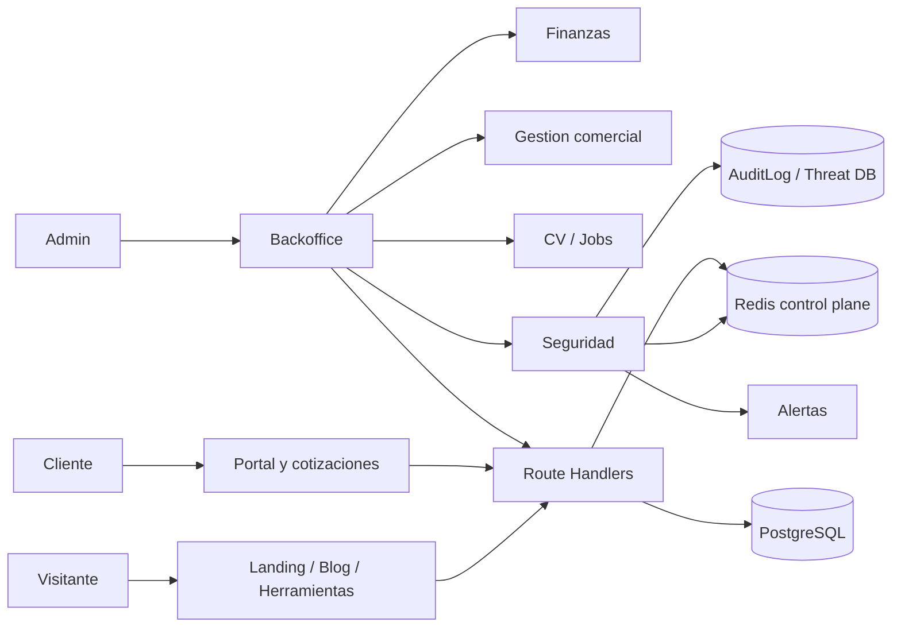
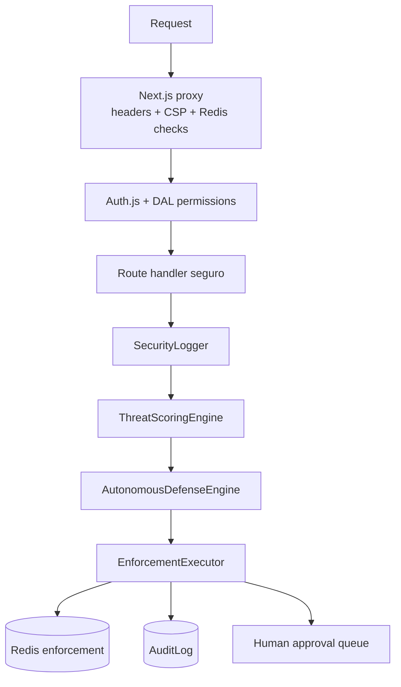

<div align="center">

# Portafolio Full-Stack

**Portfolio publico + plataforma operativa privada + laboratorios de herramientas + defensa autonoma controlada.**

[](APP/NEXT_APP)
[](APP/NEXT_APP/package.json)
[](APP/NEXT_APP/prisma/schema.prisma)
[](DOCKER)
[](APP/NEXT_APP/docs/SECURITY_OPERATIONS_RUNBOOK.md)
[](APP/NEXT_APP/package.json)
[](APP/NEXT_APP/docs/SECURITY_OPERATIONS_RUNBOOK.md)

</div>

---

## Vision

Este repositorio contiene una aplicacion Next.js productiva, no una landing aislada. Une presencia publica, herramientas tecnicas, administracion interna, finanzas personales, gestion comercial, cotizaciones, CV/jobs, portal de clientes, notificaciones, superadmin VPS y un plano de seguridad con auditoria y defensa autonoma reversible.

La filosofia del proyecto es simple:

> Construir una plataforma personal/profesional que pueda vivir mucho tiempo: mantenible, auditable, actualizada y operable bajo presion.

---

## Mapa Del Sistema



---

## Estado Actual

| Capa | Estado |
| --- | --- |
| **Framework** | Next.js 16 + React 19 + App Router |
| **Runtime** | Node.js 22/24 soportado, pnpm 10.33.0 |
| **Datos** | PostgreSQL + Prisma 7 |
| **Control plane** | Redis con AOF, `appendfsync everysec`, `noeviction` |
| **UI** | Tailwind CSS 4, Framer Motion, GSAP, lucide-react |
| **IA** | OpenRouter/Groq segun modulo y disponibilidad |
| **Seguridad** | Zero Trust, MFA, RBAC, AuditLog, CSP, SOAR-lite, AbuseIPDB |
| **Supply chain** | GitHub Actions, CodeQL, Trivy, Gitleaks, Dependabot |

Validacion local reciente:

| Check | Resultado |
| --- | --- |
| `pnpm run lint` | OK |
| `pnpm run typecheck` | OK |
| `pnpm run build` | OK |
| `pnpm run test:e2e` | 15/15 OK |

> `pnpm audit` consulta el registry externo de npm y puede enviar inventario de dependencias. Ejecutarlo solo con aprobacion explicita del operador.

---

## Modulos Principales

| Modulo | Ruta / area | Que resuelve |
| --- | --- | --- |
| **Landing** | `/` | Presentacion publica, servicios, experiencia y arquitectura |
| **Blog** | `/blog` | Contenido editorial y tecnico |
| **Herramientas** | `/herramientas/*` | QR, regex, JSON, JWT, DNS, imagenes, unidades, subredes, metadatos y mas |
| **Acceso** | `/acceso` | Login, MFA y recuperacion |
| **Admin** | `/admin` | Dashboard operativo y navegacion interna |
| **Finanzas** | `/admin/finance` + `/api/finance/*` | Cuentas, transacciones, OCR, presupuestos, metas, reportes y recordatorios |
| **Gestion comercial** | `/admin/gestion-comercial` | Clientes, pipeline, propuestas, contratos, pagos y gastos |
| **Cotizaciones** | `/admin/cotizaciones`, `/cotizacion/*` | Cotizaciones, enlaces compartidos, aprobaciones y pagos |
| **CV / Jobs** | `/admin/cv-editor`, `/admin/jobs` | CV builder, vacantes, aplicaciones, analisis y adaptacion |
| **Portal** | `/portal/[slug]` | Acceso controlado a recursos compartidos |
| **Pulse** | `/api/pulse/*` | Contexto, noticias, push notifications y paneles auxiliares |
| **Seguridad** | `/admin/security` | Incidentes, metricas, cola humana y defensa autonoma |
| **Superadmin** | `/admin/superadmin`, `/api/superadmin/*` | Operacion avanzada del VPS y diagnostico restringido |

---

## Arquitectura Del Repo

```text
Portafolio/
├── APP/NEXT_APP/              # Aplicacion Next.js principal
│   ├── src/app/               # App Router, paginas y route handlers
│   ├── src/modules/           # Dominios: landing, finance, cv, pulse, quotations
│   ├── src/lib/               # Auth, Prisma, Redis, seguridad, auditoria, SOAR-lite
│   ├── prisma/                # Schema, migraciones y seed
│   ├── scripts/               # Operaciones, seguridad y mantenimiento
│   ├── tests/e2e/             # Playwright
│   └── docs/                  # Runbooks, guias, specs y roadmap
├── DOCKER/                    # Stack Docker operativo para VPS
├── .github/workflows/         # CI, CodeQL y security scans
└── README.md                  # Vista general del repositorio
```

---

## Seguridad Y Operacion

La seguridad esta disenada como defensa por capas, alineada con criterios de NIST, OWASP, MITRE ATT&CK, CISA Secure by Design y CIS Controls.



Controles destacados:

| Control | Implementacion |
| --- | --- |
| Autenticacion | Auth.js/NextAuth v5, Argon2id, pepper, MFA |
| Autorizacion | RBAC, permisos granulares, DAL server-side |
| Navegador | CSP con nonce, HSTS, headers restrictivos |
| API | Rate limit Redis, validacion, sanitizacion, bloqueos tempranos |
| Deteccion | SecurityLogger, scoring Redis/PostgreSQL, AbuseIPDB |
| Respuesta | Lower rate limit, cooldown, MFA step-up, temp block con TTL |
| Irreversibles | Cola humana obligatoria |
| Forense | AuditLog, ThreatScoreHistory, ThreatPendingAction |
| Supply chain | pnpm lockfile unico, CodeQL, Trivy, Gitleaks, Dependabot |

Docs clave:

- [Security Operations Runbook](APP/NEXT_APP/docs/SECURITY_OPERATIONS_RUNBOOK.md)
- [Security Update Policy](APP/NEXT_APP/docs/SECURITY_UPDATE_POLICY.md)
- [Autonomous Defense + PQC Roadmap](APP/NEXT_APP/docs/AUTONOMOUS_DEFENSE_AND_PQC_ROADMAP.md)
- [Security Guide](APP/NEXT_APP/docs/SECURITY_GUIDE.md)
- [Cloudflare WAF](APP/NEXT_APP/docs/CLOUDFLARE_WAF_SETUP.md)
- [DNS Security](APP/NEXT_APP/docs/DNS_SECURITY_SETUP.md)

---

## Redis: Persistencia Y Recuperacion

Redis es parte del plano de seguridad. En produccion debe correr con:

```text
appendonly yes
appendfsync everysec
maxmemory-policy noeviction
volumen persistente /data
puerto interno o 127.0.0.1
FLUSHALL / FLUSHDB deshabilitados donde aplique
```

La politica de recuperacion y HA esta documentada en [SECURITY_OPERATIONS_RUNBOOK.md](APP/NEXT_APP/docs/SECURITY_OPERATIONS_RUNBOOK.md).

---

## Revision De Falsos Positivos

Antes de activar defensa autonoma:

```bash
cd APP/NEXT_APP
pnpm run security:false-positives -- --days 7 --min-score 70
```

Regla operativa:

| Resultado | Decision |
| --- | --- |
| `falsePositiveRate <= 2%` | Revisar muestras y avanzar con cautela |
| `falsePositiveRate > 2%` | Mantener `dry-run` y ajustar pesos/umbrales |

---

## Desarrollo Local

Requisitos:

- Node.js `>=22.22.0 <25`
- pnpm `>=10.33.0 <11`
- PostgreSQL
- Redis

```bash
cd APP/NEXT_APP
corepack enable
corepack prepare pnpm@10.33.0 --activate
pnpm install --frozen-lockfile
cp .env.example .env
pnpm exec prisma migrate dev
pnpm exec tsx prisma/seed.ts
pnpm run dev
```

La app queda en `http://localhost:3000`.

---

## Comandos Frecuentes

```bash
cd APP/NEXT_APP

pnpm run dev
pnpm run lint
pnpm run typecheck
pnpm run build
pnpm run test:e2e
pnpm run security:false-positives -- --days 7 --min-score 70
```

---

## Docker

Stack operativo principal:

```bash
cd DOCKER
cp .env.example .env
./sync-secrets.sh
docker compose up -d
```

Stack de app aislado:

```bash
cd APP/NEXT_APP
docker compose -f docker-compose.prod.yml up -d
```

Antes de produccion:

- configurar secretos reales;
- aplicar migraciones con `pnpm exec prisma migrate deploy`;
- probar healthchecks;
- verificar Redis AOF;
- mantener `AUTONOMOUS_DEFENSE_MODE=dry-run` minimo 7 dias.

---

## Politica De Dependencias

| Regla | Criterio |
| --- | --- |
| Versiones | Estables recientes/LTS por defecto |
| Betas | Evitarlas salvo decision explicita |
| Lockfile | Solo `pnpm-lock.yaml` |
| Urgencias | Priorizar CVE/GHSA/NVD/CISA KEV |
| Validacion | lint, typecheck, build, E2E y scans |

---

## Checklist De Produccion

```text
[ ] NEXTAUTH_SECRET, ENCRYPTION_KEY, PASSWORD_PEPPER, IP_HASH_SECRET generados
[ ] Redis con AOF, noeviction y volumen persistente
[ ] PostgreSQL con volumen persistente y usuario de menor privilegio
[ ] Migraciones Prisma aplicadas
[ ] GitHub Actions verdes
[ ] Alertas de seguridad configuradas
[ ] 7 dias dry-run revisados
[ ] Falsos positivos <= 2%
[ ] Backups y restore probados
```

---

## Licencia

Proyecto privado/personal de portafolio y operaciones. No subir credenciales, dumps, llaves ni archivos locales sensibles.
