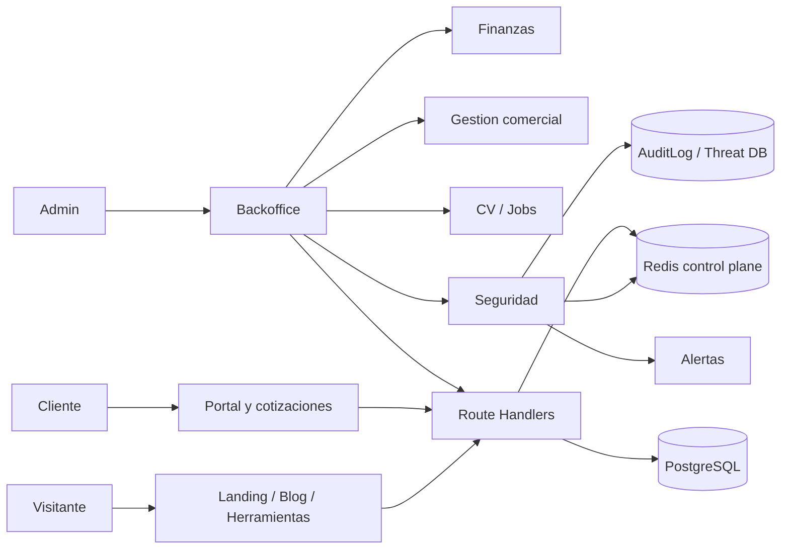
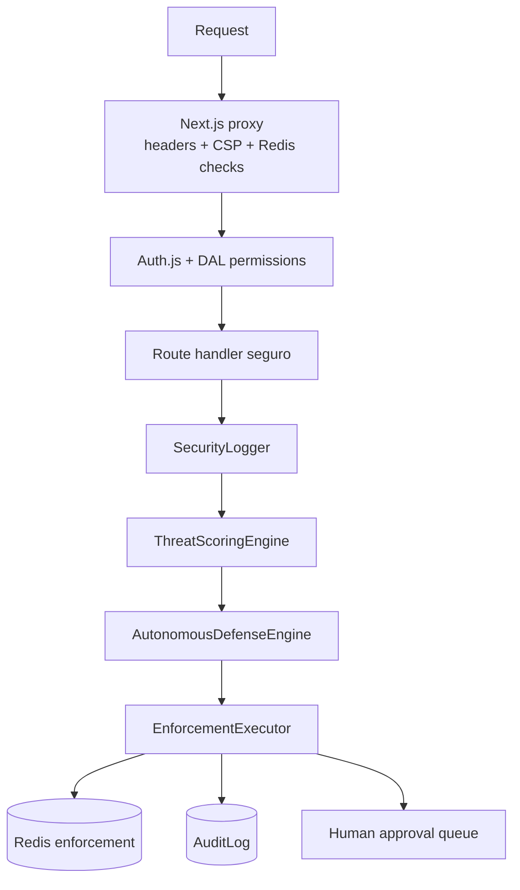

# nicoholas.dev

Sitio de **Nicoholas Lopetegui**, desarrollador full stack e ingeniero en informática en Chile. Este repositorio tiene el
código completo: el sitio público y la plataforma privada que lo acompaña (panel, portal de clientes, cotizaciones y
finanzas).

[](APP/NEXT_APP)
[](APP/NEXT_APP/package.json)
[](APP/NEXT_APP/prisma/schema.prisma)
[](DOCKER)
[](APP/NEXT_APP/tests/e2e)

## Qué hay en el sitio

- **[Servicios](https://nicoholas.dev/servicios):** desarrollo web a medida, en Chile y a distancia. Tiendas en línea,
  sistemas internos e intranets, y herramientas web y automatizaciones, cada uno con su caso real (por ejemplo, la
  tienda en línea de [FloresDyD](https://floresdyd.cl)).
- **[Herramientas](https://nicoholas.dev/herramientas):** 33 herramientas gratuitas, en español y sin registro; 30
  funcionan enteras en el navegador. Van de un generador de códigos QR a calculadoras chilenas de sueldo líquido,
  boleta de honorarios, UF y UTM, y un validador de RUT.
- **[Índice de la Web Chilena](https://nicoholas.dev/indice-web-chilena):** los sitios de 809 instituciones públicas y
  universidades de Chile, medidos en siete dimensiones: velocidad, buscadores, IA, seguridad, correo, privacidad y
  directorios. Datos abiertos (CC BY 4.0) y [metodología pública](https://nicoholas.dev/indice-web-chilena/metodologia).
- **[Cómo se hizo](https://nicoholas.dev/como-se-hizo):** el método detrás de cada parte (medir, revisar a los mejores,
  decidir por escrito y comprobar con pruebas) y el estudio de cada herramienta.
- **[Blog](https://nicoholas.dev/blog)** y **[Sobre mí](https://nicoholas.dev/sobre-mi)**.

Contacto: contacto@nicoholas.dev o el formulario de [nicoholas.dev](https://nicoholas.dev/#contacto).
LinkedIn: [nicoholas-lopetegui](https://www.linkedin.com/in/nicoholas-lopetegui/).

---

## Visión

Esta es una aplicación Next.js en producción, no una landing aislada. Une la presencia pública, las herramientas, la
administración interna, las finanzas personales, la gestión comercial, las cotizaciones, el CV y las postulaciones, el
portal de clientes, las notificaciones y un plano de seguridad con auditoría y defensa automática reversible.

> Una plataforma personal y profesional pensada para durar: mantenible, auditable, al día y operable bajo presión.

---

## Mapa Del Sistema



---

## Estado Actual

| Capa | Estado |
| --- | --- |
| **Framework** | Next.js 16 + React 19 + App Router |
| **Runtime** | Node.js 22/24 soportado, pnpm 10.33.0 |
| **Datos** | PostgreSQL + Prisma 7 |
| **Control plane** | Redis con AOF, `appendfsync everysec`, `noeviction` |
| **UI** | Tailwind CSS 4, Framer Motion, GSAP, lucide-react |
| **IA** | OpenRouter/Groq segun modulo y disponibilidad |
| **Seguridad** | Zero Trust, MFA, RBAC, AuditLog, CSP, SOAR-lite, AbuseIPDB |
| **Supply chain** | GitHub Actions, CodeQL, Trivy, Gitleaks, Dependabot |

Pruebas: más de 450 automáticas con Playwright en `APP/NEXT_APP/tests/e2e`; la mayoría abre el sitio en un navegador real.

> `pnpm audit` consulta el registry externo de npm y puede enviar inventario de dependencias. Ejecutarlo solo con aprobacion explicita del operador.

---

## Modulos Principales

| Modulo | Ruta / area | Que resuelve |
| --- | --- | --- |
| **Landing** | `/` | Presentacion publica, servicios, experiencia y arquitectura |
| **Blog** | `/blog` | Contenido editorial y tecnico |
| **Herramientas** | `/herramientas/*` | QR, regex, JSON, JWT, DNS, imagenes, unidades, subredes, metadatos y mas |
| **Acceso** | `/acceso` | Login, MFA y recuperacion |
| **Admin** | `/admin` | Dashboard operativo y navegacion interna |
| **Finanzas** | `/admin/finance` + `/api/finance/*` | Cuentas, transacciones, OCR, presupuestos, metas, reportes y recordatorios |
| **Gestion comercial** | `/admin/gestion-comercial` | Clientes, pipeline, propuestas, contratos, pagos y gastos |
| **Cotizaciones** | `/admin/cotizaciones`, `/cotizacion/*` | Cotizaciones, enlaces compartidos, aprobaciones y pagos |
| **CV / Jobs** | `/admin/cv-editor`, `/admin/jobs` | CV builder, vacantes, aplicaciones, analisis y adaptacion |
| **Portal** | `/portal/[slug]` | Acceso controlado a recursos compartidos |
| **Pulse** | `/api/pulse/*` | Contexto, noticias, push notifications y paneles auxiliares |
| **Seguridad** | `/admin/security` | Incidentes, metricas, cola humana y defensa autonoma |
| **Superadmin** | `/admin/superadmin`, `/api/superadmin/*` | Operacion avanzada del VPS y diagnostico restringido |

---

## Arquitectura Del Repo

```text
Portafolio/
├── APP/NEXT_APP/              # Aplicacion Next.js principal
│   ├── src/app/               # App Router, paginas y route handlers
│   ├── src/modules/           # Dominios: landing, finance, cv, pulse, quotations
│   ├── src/lib/               # Auth, Prisma, Redis, seguridad, auditoria, SOAR-lite
│   ├── prisma/                # Schema, migraciones y seed
│   ├── scripts/               # Operaciones, seguridad y mantenimiento
│   ├── tests/e2e/             # Playwright
│   └── docs/                  # Runbooks, guias, specs y roadmap
├── DOCKER/                    # Stack Docker operativo para VPS
├── .github/workflows/         # CI, CodeQL y security scans
└── README.md                  # Vista general del repositorio
```

---

## Seguridad Y Operacion

La seguridad esta disenada como defensa por capas, alineada con criterios de NIST, OWASP, MITRE ATT&CK, CISA Secure by Design y CIS Controls.



Controles destacados:

| Control | Implementacion |
| --- | --- |
| Autenticacion | Auth.js/NextAuth v5, Argon2id, pepper, MFA |
| Autorizacion | RBAC, permisos granulares, DAL server-side |
| Navegador | CSP con nonce, HSTS, headers restrictivos |
| API | Rate limit Redis, validacion, sanitizacion, bloqueos tempranos |
| Deteccion | SecurityLogger, scoring Redis/PostgreSQL, AbuseIPDB |
| Respuesta | Lower rate limit, cooldown, MFA step-up, temp block con TTL |
| Irreversibles | Cola humana obligatoria |
| Forense | AuditLog, ThreatScoreHistory, ThreatPendingAction |
| Supply chain | pnpm lockfile unico, CodeQL, Trivy, Gitleaks, Dependabot |

Docs clave:

- [Security Operations Runbook](APP/NEXT_APP/docs/SECURITY_OPERATIONS_RUNBOOK.md)
- [Security Update Policy](APP/NEXT_APP/docs/SECURITY_UPDATE_POLICY.md)
- [Autonomous Defense + PQC Roadmap](APP/NEXT_APP/docs/AUTONOMOUS_DEFENSE_AND_PQC_ROADMAP.md)
- [Security Guide](APP/NEXT_APP/docs/SECURITY_GUIDE.md)
- [Cloudflare WAF](APP/NEXT_APP/docs/CLOUDFLARE_WAF_SETUP.md)
- [DNS Security](APP/NEXT_APP/docs/DNS_SECURITY_SETUP.md)

---

## Redis: Persistencia Y Recuperacion

Redis es parte del plano de seguridad. En produccion debe correr con:

```text
appendonly yes
appendfsync everysec
maxmemory-policy noeviction
volumen persistente /data
puerto interno o 127.0.0.1
FLUSHALL / FLUSHDB deshabilitados donde aplique
```

La politica de recuperacion y HA esta documentada en [SECURITY_OPERATIONS_RUNBOOK.md](APP/NEXT_APP/docs/SECURITY_OPERATIONS_RUNBOOK.md).

---

## Revision De Falsos Positivos

Antes de activar defensa autonoma:

```bash
cd APP/NEXT_APP
pnpm run security:false-positives -- --days 7 --min-score 70
```

Regla operativa:

| Resultado | Decision |
| --- | --- |
| `falsePositiveRate <= 2%` | Revisar muestras y avanzar con cautela |
| `falsePositiveRate > 2%` | Mantener `dry-run` y ajustar pesos/umbrales |

---

## Desarrollo Local

Requisitos:

- Node.js `>=22.22.0 <25`
- pnpm `>=10.33.0 <11`
- PostgreSQL
- Redis

```bash
cd APP/NEXT_APP
corepack enable
corepack prepare pnpm@10.33.0 --activate
pnpm install --frozen-lockfile
cp .env.example .env
pnpm exec prisma migrate dev
pnpm exec tsx prisma/seed.ts
pnpm run dev
```

La app queda en `http://localhost:3000`.

---

## Comandos Frecuentes

```bash
cd APP/NEXT_APP

pnpm run dev
pnpm run lint
pnpm run typecheck
pnpm run build
pnpm run test:e2e
pnpm run security:false-positives -- --days 7 --min-score 70
```

---

## Docker

Stack operativo principal:

```bash
cd DOCKER
cp .env.example .env
./sync-secrets.sh
docker compose up -d
```

Stack de app aislado:

```bash
cd APP/NEXT_APP
docker compose -f docker-compose.prod.yml up -d
```

Antes de produccion:

- configurar secretos reales;
- aplicar migraciones con `pnpm exec prisma migrate deploy`;
- probar healthchecks;
- verificar Redis AOF;
- mantener `AUTONOMOUS_DEFENSE_MODE=dry-run` minimo 7 dias.

---

## Politica De Dependencias

| Regla | Criterio |
| --- | --- |
| Versiones | Estables recientes/LTS por defecto |
| Betas | Evitarlas salvo decision explicita |
| Lockfile | Solo `pnpm-lock.yaml` |
| Urgencias | Priorizar CVE/GHSA/NVD/CISA KEV |
| Validacion | lint, typecheck, build, E2E y scans |

---

## Checklist De Produccion

```text
[ ] NEXTAUTH_SECRET, ENCRYPTION_KEY, PASSWORD_PEPPER, IP_HASH_SECRET generados
[ ] Redis con AOF, noeviction y volumen persistente
[ ] PostgreSQL con volumen persistente y usuario de menor privilegio
[ ] Migraciones Prisma aplicadas
[ ] GitHub Actions verdes
[ ] Alertas de seguridad configuradas
[ ] 7 dias dry-run revisados
[ ] Falsos positivos <= 2%
[ ] Backups y restore probados
```

---

## Licencia

Proyecto privado/personal de portafolio y operaciones. No subir credenciales, dumps, llaves ni archivos locales sensibles.
